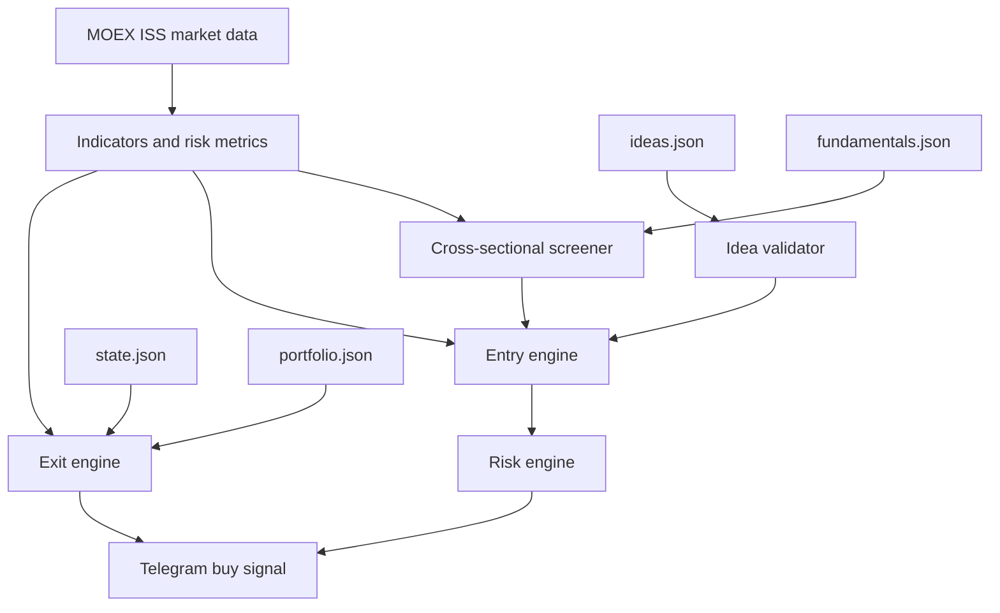

# MOEX Tracker v4 — спецификация спекулятивной стратегии

## 1. Цель и принципы

v4 переводит портфель в полностью спекулятивный режим:

- **Нет ядра.** Все акции торгуемые. Любая позиция может быть закрыта стопом, последней ступенью ладдера, истечением горизонта или инвалидацией идеи.
- **Источник идей — ВТБ Инвестиции.** Новые покупки только по активным идеям из [`ideas.json`](ideas.json). Скринер не покупает сам, он ранжирует вселенную и объясняет оценку.
- **Горизонт — недели/месяцы.** Идея живёт до `valid_until`; после горизонта позиция закрывается, если цель не достигнута.
- **Максимизируем математическое ожидание на единицу риска (E/R), а не абсолютную прибыль.** Это единственная корректная форма компромисса «минимальный риск — максимальная прибыль».
- **Строгая наука без подгонки.** Используются устойчивые, опубликованные методы: кросс-секционные факторные модели, value+momentum, low-volatility anomaly, Bayesian shrinkage, half-Kelly, volatility targeting, корреляционные кластеры, учёт комиссий и НДФЛ. Никаких чёрных ящиков и оптимизации весов на исторических данных.
- **Только long-only, cash-only, RUB, TQBR.** Без плеча, шортов, маржи и инструментов вне TQBR. Золото — только legacy до выхода, новых покупок нет.
- **Скрипт — советник.** Он не выставляет заявки. Все рекомендации приходят в Telegram; исполнение и обновление [`portfolio.json`](portfolio.json) — вручную.
- **Fail-closed.** Повреждённый `portfolio.json`, `state.json` или `ideas.json` не должен приводить к покупкам «с нуля». При ошибке итерация пропускается, exits по возможности продолжают работать.



## 2. Что удаляется

- `core_count`, `tradable_count`, `core/satellite` во всех функциях, сообщениях, дашборде, тестах и документации.
- `evaluate_buffett_health`, `run_buffett_audit`, `format_buffett_warning_message`, `--audit-buffett`, `notified_buffett`, `last_buffett_audit`.
- Поля Баффета в `fundamentals.json`: `moat`, `status`, `red_flags`, `negative_equity` как отдельный вердикт. `net_debt_ebitda`, `roe`, `fcf_positive` сохраняются как входные метрики скринера.
- Пирамидинг и усреднение вниз. Ручная докупка переинициализирует план как новую сделку.
- Автоматический перезаход после стопа. После полного выхода позиция помечается закрытой; новые покупки только по новой идее и после обновления `portfolio.json`.
- Повторные ежедневные стоп-алерты по уже закрытой позиции.

## 3. Файлы

| Файл | Назначение | Кто меняет |
|---|---|---|
| [`portfolio.json`](portfolio.json) | Фактические позиции и `CASH` | Пользователь после исполнения |
| [`ideas.json`](ideas.json) | Идеи ВТБ: зона входа, цель, стоп, горизонт, уверенность | Пользователь |
| [`fundamentals.json`](fundamentals.json) | P/E, P/B, EV/EBITDA, ROE, FCF yield, долг, рост, дивиденды | Пользователь, раз в квартал |
| `state.json` | План позиций, стадии, стопы, пики, статистика | Скрипт, атомарно |
| `notifications.json` | Журнал уведомлений и paper-сделок | Скрипт, атомарно |
| `plans/v4-spec.md` | Эта спецификация | Архитектор |

Входные файлы скрипт не переписывает, кроме явной команды `--migrate`. Все записи состояния — только `tmp` + `os.fsync()` + `os.replace()`.

## 4. Схемы JSON

### 4.1. `portfolio.json`

```json
{
  "SBER": { "count": 14, "buy_price": 285.99 },
  "GOLD": { "count": 9652, "buy_price": 2.7855 },
  "CASH": 10448
}
```

- `core_count` игнорируется и удаляется командой `--migrate`.
- `count <= 0` означает закрытую позицию.
- `buy_price` — средняя цена покупки для P&L и НДФЛ.
- Если файл отсутствует или повреждён — итерация не торгует.

### 4.2. `ideas.json`

```json
{
  "_meta": { "schema_version": 1, "updated": "2026-11-06" },
  "SBER": {
    "name": "Сбербанк",
    "sector": "Банки",
    "source": "VTB My Investments",
    "published": "2026-11-01",
    "valid_until": "2027-05-01",
    "entry_low": 280.0,
    "entry_high": 300.0,
    "target": 380.0,
    "stop": 255.0,
    "conviction": 4,
    "active": true,
    "thesis": "Краткий тезис аналитика",
    "target_history": [
      { "date": "2026-11-01", "target": 380.0 }
    ]
  }
}
```

Обязательные поля: `entry_low`, `entry_high`, `target`, `published`, `valid_until`, `conviction`.

Валидация:

- `entry_low <= entry_high`, `target > entry_high`, `stop < entry_low` если задан.
- `published < valid_until`; горизонт не больше `MAX_TRADING_HORIZON_DAYS`.
- `conviction` в диапазоне 1..5.
- Тикер существует в TQBR, не является золотом, не шорт.
- Одна активная идея на тикер: выбирается последняя по `published`.
- `upside_pct = target / price - 1 >= MIN_UPSIDE_PCT` проверяется уже на рынке.
- `active=false` или истёкший `valid_until` — новых входов нет; удерживаемая позиция закрывается по thesis/time exit.

### 4.3. `fundamentals.json`

```json
{
  "_meta": { "schema_version": 2, "updated": "2026-11-06" },
  "SBER": {
    "name": "Сбербанк",
    "sector": "Банки",
    "listing_level": 1,
    "pe": 4.5,
    "pb": 1.1,
    "ev_ebitda": null,
    "roe": 24.5,
    "fcf_yield": 12.0,
    "fcf_positive": true,
    "net_debt_ebitda": 0.0,
    "eps_growth": 8.0,
    "revenue_growth": 5.0,
    "div_yield": 9.0,
    "earnings_stability": 0.85
  }
}
```

- Все доходности и роста — в процентах (`24.5`, а не `0.245`).
- `pe`, `pb`, `ev_ebitda` — положительные мультипликаторы; `null` для неприменимых (например, EV/EBITDA у банков).
- `net_debt_ebitda` — мультипликатор; отрицательное значение означает чистую денежную позицию.
- `fcf_yield`, `div_yield`, `eps_growth`, `revenue_growth` — проценты.
- `earnings_stability` — 0..1, опционально.
- `_meta.updated` старше `FUNDAMENTALS_WARN_DAYS` — предупреждение; старше `FUNDAMENTALS_HARD_STALE_DAYS` — новые входы по тикеру запрещены.
- Сектора нормализуются через таблицу синонимов, чтобы sector-neutral z-scores были корректны.

### 4.4. `state.json` v4

```json
{
  "schema_version": 4,
  "positions": {
    "SBER": {
      "avg_cost": 285.99,
      "plan_anchor": 299.0,
      "entry_atr": 3.89,
      "current_atr": 4.10,
      "initial_stop": 271.0,
      "stop_current": 286.7,
      "risk_per_share": 28.0,
      "initial_risk_rub": 2240.0,
      "targets": [327.0, 355.0, 380.0],
      "stage": 1,
      "sold": 32,
      "original_count": 80,
      "peak": 330.0,
      "opened_at": "2026-11-06T14:00:00+03:00",
      "valid_until": "2027-05-01",
      "idea_target": 380.0,
      "idea_published": "2026-11-01",
      "idea_active": true,
      "legacy": false,
      "exit_alerted": false,
      "realized_pnl": 1200.0,
      "realized_r": 0.54
    }
  },
  "closed_trades": [],
  "stats": { "wins": 0, "losses": 0, "gross_profit": 0.0, "gross_loss": 0.0 },
  "equity_peak": 0.0,
  "day_start_equity": 0.0,
  "day_date": "",
  "halt_new_entries_until": "",
  "notified_date": "",
  "notified_buy": [],
  "notified_profit": [],
  "notified_stop": [],
  "last_screen": {}
}
```

- `avg_cost` — только для P&L и налога.
- `plan_anchor` — форвардная точка отсчёта R и целей. Для новой покупки равна цене входа; для legacy и adoption идеи — текущей цене. Это устраняет ошибку привязки к невозвратным затратам (sunk cost fallacy).
- `initial_stop`/`stop_current` только повышаются, никогда не понижаются.
- `stage` и `sold` — исполненные ступени ладдера.
- `exit_alerted` блокирует повторные стоп-алерты до обновления портфеля или `--reset-plan`.
- `closed_trades` ограничен `MAX_TRADE_LOG`.

## 5. Математическая модель

### 5.1. R, R:R и математическое ожидание

Для каждой идеи:

```text
anchor          = цена исполнения входа (ask, иначе last)
stop0           = max(idea.stop, entry_low - 1.0 * ATR)   если idea.stop задан
                  entry_low - 1.0 * ATR                   иначе
R               = anchor - stop0
target_r        = (target - anchor) / R
risk_pct        = R / anchor
```

Жёсткие ворота входа:

```text
target_r >= MIN_RR = 2.0
risk_pct <= MAX_STOP_DISTANCE_PCT = 18%
upside_pct = target / anchor - 1 >= MIN_UPSIDE_PCT = 10%
```

Ожидание считается после комиссий, с slippage и НДФЛ:

```text
c = COMMISSION_PCT/100 + SLIPPAGE_PCT/100
tau = TAX_PCT/100

net_win  = (target - anchor) * (1 - tau) - c * (target + anchor)
net_loss = R + c * (anchor + stop0)

E_R = p * (net_win / R) - (1 - p) * (net_loss / R)
E_R >= MIN_EXPECTANCY_R = 0.05
```

Вероятность успеха `p` — байесовская, а не «уверенность аналитика»:

```text
p = (wins + PRIOR_WINS) / (wins + losses + PRIOR_WINS + PRIOR_LOSSES)
PRIOR_WINS = 4, PRIOR_LOSSES = 6   # prior mean 0.40
p = clamp(p, 0.30, 0.55)
```

`conviction` используется только как tie-breaker между кандидатами с близким `E_R` (в пределах 0.05R) и не увеличивает размер позиции. Это защита от ложной точности.

### 5.2. Безубыток с учётом комиссий и налога

```text
net(P) = (P - B) * (1 - tau) - c * (P + B)
breakeven_price = B * (1 - tau + c) / (1 - tau - c)
```

При `c = 0.0015` и `tau = 0.13` безубыток примерно `B * 1.00345` (+0.35%). Стоп после TP1 переносится не в `buy`, а в `breakeven_price`.

### 5.3. Динамический ладдер

Ладдер строится от `plan_anchor` и `R`, а не от произвольных ATR-множителей. Последняя ступень всегда продаёт всю оставшуюся позицию.

Если `target_r >= 3.0`:

| Ступень | Уровень | Доля исходной позиции | Действие |
|---|---|---|---|
| TP1 | `anchor + 1.0R` | 40% | продать, стоп в безубыток |
| TP2 | `anchor + 2.0R` | 30% | продать, стоп на `anchor + 1.0R` |
| TP3 | `target` | весь остаток | продать всё |

Если `2.0 <= target_r < 3.0`:

| Ступень | Уровень | Доля исходной позиции | Действие |
|---|---|---|---|
| TP1 | `anchor + 1.0R` | 50% | продать, стоп в безубыток |
| TP2 | `target` | весь остаток | продать всё |

Количества округляются вниз до лота. Если остаток меньше лота, скрипт сообщает о необходимости ручной продажи остатка. При гэпе через несколько ступеней исполняются все достигнутые ступени; последняя ступень продаёт весь остаток только если это финальная ступень.

### 5.4. Стопы

- Начальный стоп: `stop0` из 5.1, но не ближе `MAX_STOP_DISTANCE_PCT` к цене; иначе идея отклоняется.
- Chandelier: `peak - TRAILING_ATR_MULT * min(entry_atr, current_atr)`. Использование минимума ATR не позволяет стопу расширяться при росте волатильности.
- До TP1: если `peak >= anchor + 0.75R`, стоп поднимается до `anchor + 0.25R` (pre-TP1 защита).
- После TP1: `stop = max(stop, breakeven_price, anchor + 0.25R, chandelier)`.
- После TP2: `stop = max(stop, anchor + 1.0R, chandelier)`.
- `stop_current` обновляется только вверх. Проверка триггера — по `min(last, bid)`, то есть по цене, по которой реально можно продать. TP-триггер — по `bid` (если bid отсутствует, по `last`).
- При гэпе ниже стопа уведомление указывает фактическую цену и исполнение по рынку.

### 5.5. Сайзинг и портфельные лимиты

```text
risk_rub        = equity * RISK_PER_TRADE_PCT
shares_risk     = risk_rub / R
shares_position = equity * MAX_POSITION_PCT / anchor
shares_cash     = max(0, cash - equity * MIN_CASH_PCT) / anchor
shares_adv      = ADV * MAX_ADV_PCT / anchor
f_kelly         = max(0, (p * target_r - (1 - p)) / target_r)
shares_kelly    = equity * min(KELLY_FRACTION * f_kelly, MAX_POSITION_PCT) / anchor
shares          = floor(min(shares_risk, shares_position, shares_cash,
                            shares_adv, shares_kelly) / lot) * lot
```

После расчёта проверяются:

| Лимит | Значение | Смысл |
|---|---|---|
| `RISK_PER_TRADE_PCT` | 0.75% | риск на сделку |
| `MAX_POSITION_PCT` | 15% | максимум на бумагу |
| `MAX_PORTFOLIO_HEAT_PCT` | 5% | суммарный открытый риск |
| `MAX_SECTOR_PCT` | 30% | секторная концентрация |
| `MAX_POSITIONS` | 10 | число позиций |
| `MAX_ADV_PCT` | 1% | доля дневного оборота |
| `MIN_CASH_PCT` | 10% | резерв кэша |
| `MAX_PORTFOLIO_VOL_PCT` | 25% | годовая волатильность портфеля |
| `CORR_CLUSTER_THRESHOLD` | 0.75 | порог корреляционного кластера |
| `MAX_CLUSTER_PCT` | 30% | лимит на кластер |
| `PORTFOLIO_DD_HALT_PCT` | 10% | стоп новых входов при просадке |
| `MAX_DAILY_LOSS_PCT` | 3% | дневной лимит убытка |

Портфельная волатильность считается по 60-дневным доходностям и ковариационной матрице; при превышении лимита размер кандидата итеративно уменьшается. Корреляционный кластер — жадная группировка по `rho >= 0.75`; при недостатке данных используется сектор как прокси кластера.

Circuit breakers не ликвидируют позиции принудительно: они запрещают новые входы и шлют уведомление. Выходы по стопам продолжают работать.

### 5.6. Скринер вместо Баффета

Вселенная: тикеры из `ideas.json`, `fundamentals.json` и текущего портфеля.

Факторы и веса:

| Фактор | Вес | Метрики |
|---|---|---|
| Value | 30% | E/P, B/P, FCF yield, EBITDA/EV; sector-neutral |
| Quality | 20% | ROE, `-NetDebt/EBITDA`, положительный FCF, стабильность прибыли |
| Growth | 10% | рост EPS, рост выручки |
| Momentum | 20% | 12-1, 6-1 относительно IMOEX, тренд выше SMA200 |
| Risk | 10% | `-vol60`, `-maxDD252`, `-beta` |
| Idea | 10% | `E_R` активной идеи; иначе 0 |

Расчёт:

1. Винзоризация метрик на 5%/95% перцентилях.
2. Sector-neutral z-score: `z = (x - median_sector) / (1.4826 * MAD_universe)`, клип ±3.
3. Пропуски — нейтральный 0; в выводе показывается completeness.
4. Композит — взвешенная сумма z-score.

Ворота «BUY NOW»:

- активная идея ВТБ и цена внутри зоны входа;
- `target_r >= 2.0`, `E_R >= MIN_EXPECTANCY_R`;
- тренд не сломан: `last > SMA200` или `SMA50 > SMA200` и `SMA200` растёт;
- `25 <= RSI <= 65`; при `RSI < 25` нужен `last > SMA200` и дневное падение не более 5%;
- `z20 <= 1.5`, `ATR% <= MAX_ATR_PCT`;
- ликвидность: `ADV >= MIN_DAILY_VOLUME`, `listing_level <= 2`;
- качество: `ROE >= 0`, `NetDebt/EBITDA <= 3.0` (кроме банков), FCF положительный или неизвестен;
- value-trap guard: `quality_score + momentum_score >= 0`;
- композитный скор `>= 0`.

Вердикты: `BUY NOW`, `WATCH`, `SCREEN ONLY`, `AVOID`. Скринер только печатает и объясняет; покупки инициирует entry engine.

## 6. Вход

Порядок итерации:

1. Загрузить и провалидировать входные файлы. При критической ошибке — пропустить итерацию.
2. Получить рынок MOEX, IMOEX, свечи, индикаторы.
3. Синхронизировать state с portfolio.
4. Обновить пики и `stop_current`.
5. Проверить выходы: stop → thesis invalidation → TP ladder → time exit.
6. Построить список кандидатов из активных идей, отсортировать по `E_R`, затем по композитному скору, затем по `conviction`.
7. Для каждого кандидата проверить ворота, рассчитать размер и портфельные лимиты. Отправить не более одного сигнала на тикер в день.
8. Сохранить state.

Сигнал на покупку содержит: идею, дату публикации, `valid_until`, зону входа, цель, стоп, R, R:R, `E_R`, `p`, размер в лотах и рублях, риск, heat после, сектор после, максимальную корреляцию, план ладдера и напоминание обновить `portfolio.json` после исполнения.

## 7. Выход

| Триггер | Действие |
|---|---|
| Стоп | Продать всю позицию, лот-выравнивание, `exit_alerted=true` |
| Thesis invalidation | Идея удалена, `active=false`, цель ниже `MIN_RR`, стоп идеи выше цены — продать всё |
| TP1 | Продать 40% или 50%, стоп в безубыток |
| TP2 | Продать 30%, стоп на `anchor + 1.0R` |
| TP3 | Продать весь остаток |
| Time exit | `valid_until + TIME_EXIT_GRACE_DAYS` — продать всё |
| Legacy time exit | `MAX_LEGACY_HOLDING_DAYS` от миграции — продать всё |

Стоп имеет приоритет над TP. Thesis invalidation имеет приоритет над TP, потому что старые цели больше недействительны. Один и тот же сигнал не повторяется ежедневно: стадии и `exit_alerted` хранятся в state.

## 8. Legacy-позиции и миграция

При первом запуске v4:

1. `state.json` v3 (есть `core_count` или нет `schema_version=4`) → backup `state.v3.backup.json`, создать новый state.
2. `portfolio.json` читается как есть; `core_count` игнорируется. Команда `--migrate` удаляет поле с backup `portfolio.v3.backup.json`.
3. `fundamentals.json` v1 → backup `fundamentals.v3.backup.json`; `roe_pct` → `roe`, `net_debt_ebitda` и `fcf_positive` сохраняются, поля Баффета удаляются, `pe`/`pb`/`ev_ebitda`/`fcf_yield`/росты/дивиденды добавляются как `null` для ручного заполнения.
4. Для каждой позиции без идеи: `legacy=true`, `plan_anchor=last`, `initial_stop=last - 3.0*ATR` (с ограничением `MAX_STOP_DISTANCE_PCT`), цели `last + 2/4/6 ATR`, `opened_at=дата миграции`.
5. Для позиции с активной идеей: `legacy=false`, `plan_anchor=last`, стоп и цели по идее. Если цель уже ниже текущей цены — сигнал thesis exit.
6. `GOLD` и другие БПИФ — только legacy, новых покупок нет.

Если `fundamentals.json` отсутствует, скринер отключается, но legacy-выходы работают. Если `ideas.json` отсутствует, новых покупок нет; удерживаемые идеи используют последний снимок из state, чтобы не ликвидировать позиции из-за случайного удаления файла.

## 9. Команды

| Команда | Назначение |
|---|---|
| `python moex_tracker.py` | основной цикл |
| `--show` | последние уведомления |
| `--send-pending` | дослать неотправленное в Telegram |
| `--screen` | количественный скрининг и рейтинг |
| `--ideas-check` | валидация `ideas.json` и `fundamentals.json` |
| `--stats` | paper-статистика: win rate, expectancy R, profit factor, max DD |
| `--migrate` | backup и миграция v3 → v4 |
| `--reset-plan TICKER` | пересчитать план от текущей цены после ручного вмешательства |

`--audit-buffett` удаляется.

## 10. Конфигурация (стартовые значения)

```python
RISK_PER_TRADE_PCT       = 0.0075
MAX_POSITION_PCT         = 0.15
MAX_PORTFOLIO_HEAT_PCT   = 0.05
MAX_SECTOR_PCT           = 0.30
MAX_POSITIONS            = 10
MAX_ADV_PCT              = 0.01
MIN_CASH_PCT             = 0.10
MAX_PORTFOLIO_VOL_PCT    = 0.25
CORR_CLUSTER_THRESHOLD   = 0.75
MAX_CLUSTER_PCT          = 0.30
PORTFOLIO_DD_HALT_PCT    = 0.10
MAX_DAILY_LOSS_PCT       = 0.03
KELLY_FRACTION           = 0.5

MIN_RR                   = 2.0
MIN_UPSIDE_PCT           = 10.0
MAX_STOP_DISTANCE_PCT    = 18.0
MIN_EXPECTANCY_R         = 0.05
PRIOR_WINS               = 4
PRIOR_LOSSES             = 6

INITIAL_STOP_ATR         = 3.0
TRAILING_ATR_MULT        = 3.0
PRE_TP1_TRIGGER_R        = 0.75
PRE_TP1_LOCK_R           = 0.25
TP1_R                    = 1.0
TP2_R                    = 2.0

MAX_TRADING_HORIZON_DAYS = 180
TIME_EXIT_GRACE_DAYS     = 5
MAX_LEGACY_HOLDING_DAYS  = 90

COMMISSION_PCT           = 0.1
TAX_PCT                  = 13.0
SLIPPAGE_PCT             = 0.05

CANDLES_DAYS_STOCKS      = 300
CANDLES_DAYS_INDEX       = 300
MIN_DAILY_VOLUME         = 30_000_000
MAX_ATR_PCT              = 8.0
BUY_RSI_MAX              = 65.0
BUY_Z_MAX                = 1.5
```

Все значения — константы в одном месте; пользователь может менять их вручную. Никакого конфиг-файла.

## 11. Тесты

[`test_fixes.py`](test_fixes.py) должен проверять:

- Wilder RSI/ATR, SMA/EMA, z-score, momentum, realized vol, max drawdown, beta, correlation, OU half-life.
- `breakeven_price`: `net_proceeds(breakeven) ≈ 0` с комиссией и налогом.
- Стоп продаёт всю позицию, лот-выровнено, без `core_count`.
- TP1/TP2/TP3: правильные cumulative quantities; финальная ступень продаёт всё.
- Динамический ладдер: `target_r=4` → 3 ступени; `target_r=2.2` → 2 ступени; `target_r<2` → отказ.
- `E_R` учитывает комиссии, slippage и НДФЛ; отрицательное ожидание отклоняется.
- Байесовский `p` обновляется после закрытых сделок и клипается.
- Сайзинг: risk cap, position cap, cash cap, ADV cap, Kelly cap, heat, sector, max positions, lot alignment.
- Корреляционный кластер и portfolio vol cap.
- Circuit breakers: drawdown и daily loss запрещают входы.
- Time exit и thesis invalidation.
- Миграция v3: backup, `core_count` игнорируется, позиции инициализируются, нет потери позиций.
- Валидация `ideas.json`: плохие даты, цель ниже входа, стоп выше входа, просроченная идея, неизвестный тикер.
- Скринер: value/quality/momentum/risk, sector-neutral z-scores, winsorization, missing data, детерминированный рейтинг.
- Дедупликация уведомлений и HTML-экранирование.
- Ручная продажа/покупка в `portfolio.json`: корректный sync, reinit при докупке, отсутствие повторных стоп-алертов.
- Тесты не зависят от реального `.env` и не ходят в сеть.

## 12. Документация и git

- [`README.md`](README.md) переписывается под v4: философия, схемы файлов, формулы, команды, миграция, дисклеймер.
- [`AGENTS.md`](AGENTS.md) обновляется: убрать core/satellite и Баффета, добавить спекулятивную модель, `ideas.json`, fail-closed, cost-aware R, полный выход.
- [`.gitignore`](.gitignore): добавить `.roo/mcp.json` (локальная конфигурация MCP), сохранить игнор `state.json` и `notifications.json`.
- Перед финалом: `python -m py_compile moex_tracker.py`, `python test_fixes.py`, `--ideas-check`, `--screen` на доступных данных.
- Коммит и push в upstream `https://github.com/baltowolf/trades.git`; рабочее дерево чистое.

## 13. Явные допущения

- Рекомендации ВТБ вносятся вручную; автоматического парсинга приложения нет.
- Фундаментальные мультипликаторы вносятся вручную и обновляются ежеквартально.
- Дивиденды в ожидании не учитываются — это консервативно.
- Налоговый вычет по убыткам не моделируется — это консервативно.
- Проскальзывание учитывается в воротах ожидания, но не в отчётном P&L.
- Скрипт не выставляет заявки; все рекомендации исполняются пользователем вручную.
- Прибыльность стратегии оценивается форвардно через `--stats`, а не подгонкой на истории.
